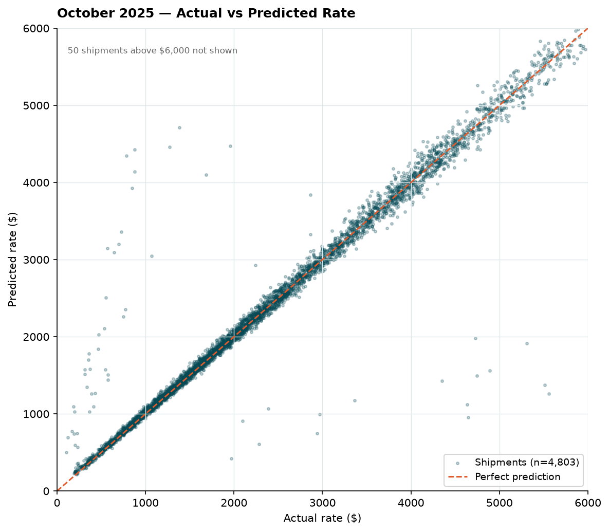
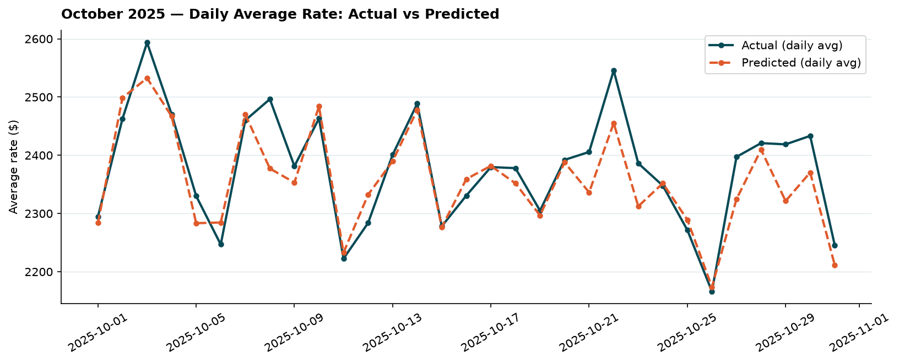
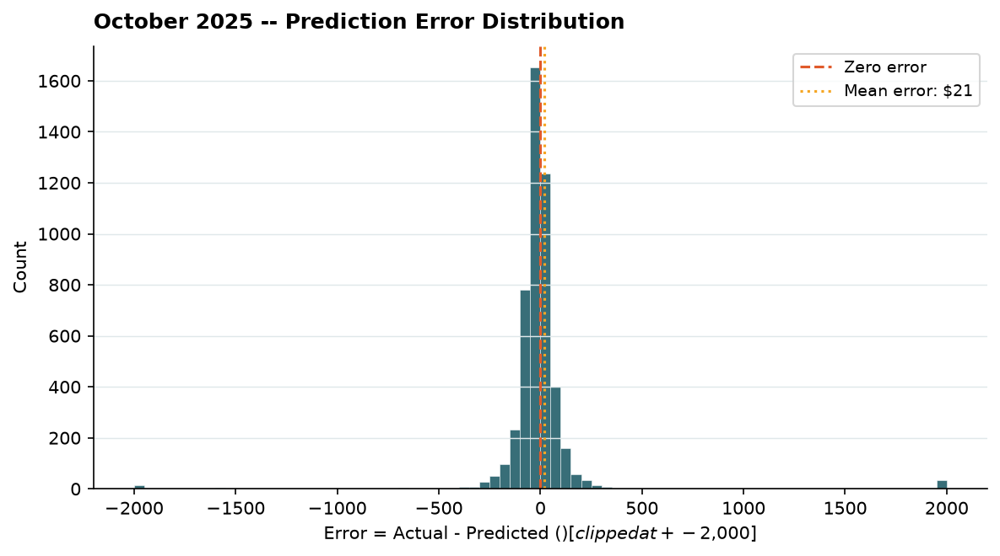

# Spotter AI - Freight Rate Prediction

A machine learning system for predicting truckload freight shipment rates. Built as part of a technical assessment using CatBoost regression with chronological validation.

---

## Table of Contents

1. [Project Overview](#1-project-overview)
2. [Dataset Understanding](#2-dataset-understanding)
3. [Feature Engineering](#3-feature-engineering)
4. [Validation Strategy](#4-validation-strategy)
5. [Model Experimentation and Selection](#5-model-experimentation-and-selection)
6. [Error Analysis and Limitations](#6-error-analysis-and-limitations)
7. [Final Model Training](#7-final-model-training)
8. [Prediction and Inference](#8-prediction-and-inference)
9. [Installation and Usage](#9-installation-and-usage)
10. [Output Validation](#10-output-validation)
11. [October Prediction Charts](#11-october-prediction-charts)
12. [Conclusion](#12-conclusion)

---

## 1. Project Overview

### Business problem

Freight brokers and shippers need accurate rate estimates for truckload shipments before a load is posted to the market. A reliable pricing model reduces manual quoting effort, improves margin predictability, and enables faster response to market conditions.

### Objective

Train a regression model on historical shipment records to predict `posted_rate` - the actual market rate paid for each shipment - and generate predictions for two distinct sets:

- **12,000 unlabeled validation shipments** spanning January-October 2025
- **31 December 2025 daily forecasts** for a fixed Lexington → Fort Wayne Dry Van lane

### Input datasets

| File | Rows | Description |
|---|---|---|
| `data/train-test.csv` | 48,000 | Labeled shipments, January-October 2025 |
| `data/validation.csv` | 12,000 | Unlabeled shipments, same period |
| `data/december-chart-inputs.csv` | 31 | Fixed route, December 2025, one row per day |

### Target variable

`posted_rate`: the actual freight rate paid for each shipment, in USD. Always positive. The model predicts this directly on its original scale.

### Deliverables

- `validation_predictions.csv` - 12,000 rows with `load_id` and `predicted_rate`
- `data/december-chart-inputs.csv` - original file with `predicted_rate` filled in
- `scorer_results/candidate_december.png` - rate trend chart for December

---

## 2. Dataset Understanding

### Labeled training data (`data/train-test.csv`)

**Shape:** 48,000 rows �- 14 columns

| Column | Type | Description |
|---|---|---|
| `load_id` | string | Unique shipment identifier (e.g., `TR-000001`) |
| `pickup` | string | Origin city |
| `delivery` | string | Destination city |
| `pickup_lat`, `pickup_lon` | float | Pickup coordinates |
| `delivery_lat`, `delivery_lon` | float | Delivery coordinates |
| `distance` | float | Reported road distance in miles |
| `equipment` | string | Trailer type: Dry Van, Reefer, or Flatbed |
| `weight` | float | Shipment weight in pounds |
| `date` | date | Shipment date |
| `market_index` | float | External market signal |
| `quote_signal` | float | External quote signal |
| `posted_rate` | float | Actual freight rate paid (target) |

**Missing values:**

| Column | Missing |
|---|---|
| `weight` | 300 |
| `market_index` | 374 |
| All other columns | 0 |

**Target distribution (`posted_rate`):**

| Statistic | Value |
|---|---|
| Min | $57.22 |
| 25th percentile | $1,251.56 |
| Median | $2,030.76 |
| Mean | $2,373.98 |
| 75th percentile | $3,330.75 |
| Max | $25,533.00 |

The distribution is right-skewed, with the large majority of shipments below $5,000 and a small tail of high-value loads.

**Equipment distribution:**

| Equipment | Records |
|---|---|
| Dry Van | 27,202 (56.7%) |
| Reefer | 12,045 (25.1%) |
| Flatbed | 8,753 (18.2%) |

**Route structure:**

- 64 unique pickup cities, 64 unique delivery cities
- 4,014 unique routes
- Median route frequency: 10 records
- 758 routes with 5 or fewer records

**Distance and rate correlation:**

Distance is the single strongest predictor, with a Pearson correlation of 0.91 with `posted_rate`. `market_index` and `quote_signal` each have near-zero raw correlation (±0.04) with the target.

**High-value shipment analysis:**

| Segment | Records | Proportion |
|---|---|---|
| Below $5,000 | 45,735 | 95.28% |
| $5,000-$10,000 | 2,162 | 4.50% |
| $10,000-$15,000 | 79 | 0.16% |
| $15,000-$20,000 | 15 | 0.03% |
| Above $20,000 | 9 | 0.02% |

Shipments above $10,000 represent 103 records out of 48,000 (0.215%). Their distribution across months is consistent: October contains 12 such records (0.247% of October), close to the dataset-wide average.

### Validation data (`data/validation.csv`)

12,000 rows with the same column structure as the training data, excluding `posted_rate`. Load IDs follow the format `TE-000001` through `TE-012000`.

### December forecast data (`data/december-chart-inputs.csv`)

31 rows, one per calendar day in December 2025. All non-date fields are fixed:

| Field | Value |
|---|---|
| pickup | Lexington |
| delivery | Fort Wayne |
| distance | 360 miles |
| equipment | Dry Van |
| weight | 32,000 lb |
| date | 2025-12-01 to 2025-12-31 |

The task is to predict how the rate for this specific lane changes day by day across December.

---

## 3. Feature Engineering

All feature engineering is implemented in `src/feature_engineering.py`. The same pipeline runs identically during training, validation, and December inference - this is enforced by the shared `prepare_features()` function, which returns a fixed-order 15-column DataFrame validated against `MODEL_FEATURES`.

The December dataset does not contain coordinates, which is why geographic features (Haversine distance) are excluded from the shared model. All 15 features are available in every dataset.

### The 15 model features

**Categorical features** (passed to CatBoost as category indices):

| Feature | Description |
|---|---|
| `pickup` | Origin city, encoded as string |
| `delivery` | Destination city, encoded as string |
| `equipment` | Trailer type (Dry Van / Reefer / Flatbed) |
| `route` | Concatenated origin and destination: `"Lexington_Fort Wayne"` |
| `distance_bin` | Distance tier (7 levels: very_short to extreme) |

**Numeric features:**

| Feature | Description |
|---|---|
| `distance` | Reported road distance in miles |
| `weight` | Shipment weight in pounds (NaN preserved) |
| `month` | Calendar month (1-12) |
| `day_of_week` | Day of week (0 = Monday, 6 = Sunday) |
| `day_of_year` | Day of year (1-366) |
| `is_weekend` | Binary: 1 if Saturday or Sunday |
| `day_sin` | Sine encoding of `day_of_year`: $\sin(2\pi \cdot d / 365.25)$ |
| `day_cos` | Cosine encoding of `day_of_year`: $\cos(2\pi \cdot d / 365.25)$ |
| `weight_missing` | Binary: 1 if weight is missing |
| `weight_per_mile` | `weight / distance` (NaN when weight is missing) |

### Distance bins

```
(-inf, 250]    → very_short
(250,  500]    → short
(500,  1000]   → medium
(1000, 1500]   → medium_long
(1500, 2000]   → long
(2000, 3000]   → very_long
(3000, +inf)   → extreme
```

### Cyclical date encoding

Raw day-of-year is not cyclical - day 365 and day 1 are numerically far apart but temporally adjacent. Sine and cosine encoding maps the annual cycle onto a continuous circle:

$$\text{day\_sin} = \sin\!\left(\frac{2\pi \cdot \text{day\_of\_year}}{365.25}\right), \quad \text{day\_cos} = \cos\!\left(\frac{2\pi \cdot \text{day\_of\_year}}{365.25}\right)$$

Both `day_sin` and `day_cos` together are retained because neither alone captures the full cycle.

### Categorical feature handling

CatBoost has two related but distinct mechanisms for handling categoricals. The ordered categorical statistics compute target-based encodings using a random permutation of training records, so each record's encoding only sees records that appear earlier in the permutation. This prevents within-batch target leakage during training. Ordered boosting is a separate mechanism that builds trees on a held-out subset to reduce overfitting. Both use the same ordered principle but operate at different levels of the algorithm. All categorical columns are cast to strings before being passed to the model. Missing categorical values are replaced with the sentinel string `"__MISSING__"`.

### Missing numeric values

CatBoost handles missing numeric values natively without imputation. `weight` is left as `NaN` when absent; `weight_per_mile` is `NaN` when weight is missing. The binary `weight_missing` flag is included so the model can distinguish between zero weight and absent weight.

---

## 4. Validation Strategy

### Why chronological splitting

Freight rates are time-dependent. A shipment on October 15 reflects market conditions that a January shipment does not. Random train-test splitting would allow future-period patterns to leak into the training set, producing overly optimistic validation scores that would not generalise to unseen future data.

All splits use a strict cutoff: the training set contains only records before the validation window start date.

### Four-window evaluation

| Window | Training period | Validation period | Train rows | Val rows |
|---|---|---|---|---|
| July | Jan-Jun 2025 | Jul 2025 | 28,806 | 4,912 |
| August | Jan-Jul 2025 | Aug 2025 | 33,718 | 4,759 |
| September | Jan-Aug 2025 | Sep 2025 | 38,477 | 4,670 |
| October | Jan-Sep 2025 | Oct 2025 | 43,147 | 4,853 |

### Model comparison across all four windows

| Model | Avg MAE | Avg RMSE | Avg R² | Avg MAPE |
|---|---|---|---|---|
| Baseline 1 - training median | $1,138.41 | $1,550.11 | −0.0568 | 69.57% |
| Baseline 2 - distance-only linear | $193.69 | $649.19 | 0.8146 | 9.73% |
| CatBoost 15-feature model | $119.00 | $629.01 | 0.8260 | 5.59% |

CatBoost reduced average MAE by approximately **38.6%** compared with the distance-only linear baseline, and by **89.5%** compared with the constant median baseline.

The distance-only baseline is a meaningful reference point because distance accounts for most of the rate variance (correlation 0.91). The remaining improvement from CatBoost reflects the value of route identity, equipment type, weight, and temporal features.

> **Note:** These are chronological validation results on held-out months from the labeled training data. They are not scores from an independent hidden test set. The final evaluation is performed by Spotter after submission.

---

## 5. Model Experimentation and Selection

All experiments used the same chronological split: January-September training, October validation. October was the primary model-selection window — every experiment result table in this section reflects performance on October. This means October is not a fully independent holdout; it was used to compare and select between configurations. Once the final configuration was chosen, the model was retrained on all 48,000 records including October before generating the submission predictions.

### Experiments conducted

| Experiment | Description | October MAE | Outcome |
|---|---|---|---|
| A | 15-feature CatBoost baseline | $115.18 | **Selected** |
| B | + `market_index`, `quote_signal` | Higher | Rejected |
| C | + log-transformed target | Higher | Rejected |
| D | + 5 additional date/interaction features, depth 10, lr 0.03 | $117.77 | Rejected |
| E | Route historical median and mean | $119.00 avg | Rejected |
| F | Equipment-route historical median | Higher | Rejected |
| G | Route + equipment-route aggregates | Higher | Rejected |
| H | Aggregates + Haversine distance | Higher | Rejected |

### Route feature experiment detail (four windows)

| Experiment | Avg MAE | vs Baseline A |
|---|---|---|
| A - 15-feature baseline | $119.00 | - |
| B - + route median/mean | $121.74 | +2.3% |
| E - + aggregates + Haversine | $130.74 | +9.9% |
| C - + equipment-route median | $135.29 | +13.7% |
| D - + route + equipment-route | $141.57 | +19.0% |

Adding explicit route-level historical statistics did not improve over the baseline. CatBoost's native ordered categorical encoding already learns category-level pricing information effectively. Pre-computed aggregates introduced noise, particularly on routes with fewer than five historical records (758 routes in the training data).

### Selected model - October validation results

| Metric | Value |
|---|---|
| MAE | $115.18 |
| RMSE | $647.80 |
| R² | 0.8204 |
| MAPE | 5.70% |
| Best iteration | 553 (selected_iterations = 554) |
| High-value MAE (>$10K) | $10,469.08 |

### Final CatBoost configuration

| Parameter | Value |
|---|---|
| `iterations` | 1,500 (configured); 554 (early stopping) |
| `depth` | 8 |
| `learning_rate` | 0.05 |
| `loss_function` | MAE |
| `eval_metric` | MAE |
| `early_stopping_rounds` | 100 |
| `random_seed` | 42 |

---

## 6. Error Analysis and Limitations

### Equipment-wise performance (October)

| Equipment | Records | MAE |
|---|---|---|
| Dry Van | ~2,750 | ~$102 |
| Reefer | ~1,220 | ~$130 |
| Flatbed | ~880 | ~$134 |

Dry Van is the most common equipment type and has the lowest MAE. Reefer and Flatbed have higher errors, consistent with their smaller training sample sizes and more variable pricing.

### Distance-wise error pattern

Errors increase with distance. Short-haul shipments (under 500 miles) are predicted more accurately than long-haul shipments (above 1,500 miles), where rate variance is higher and training data is sparser per lane.

### High-value shipment limitation

The model's primary structural limitation is underprediction of rare, high-value shipments above $10,000. These records represent 103 out of 48,000 training records (0.215%).

Examples from October validation:

| Route | Actual rate | Predicted rate |
|---|---|---|
| Milwaukee → Bakersfield | $17,514 | ~$3,614 |
| Columbia → Tucson | $17,893 | ~$4,230 |
| Boston → Bakersfield | $19,110 | ~$5,869 |

The model has limited training signal for these rates. They were not removed from the training data because there is no evidence of data corruption - their monthly distribution is consistent (0.215% overall vs 0.247% in October), suggesting they are genuine market events rather than errors.

The overall MAE of $115.18 understates the model's difficulty with extreme rates. Users should apply additional caution when using the model for shipments expected to price above $5,000.

### What was not attempted

- Removing or downweighting high-value outliers - insufficient evidence of data error
- External market data beyond the provided `market_index` and `quote_signal` - both showed near-zero raw correlation with the target and did not improve validation performance when included

---

## 7. Final Model Training

After completing all experiments and confirming the original 15-feature CatBoost configuration as the best model, the final model was retrained on all 48,000 labeled records (January-October 2025).

### Rationale for including October in final training

October was used as the validation set during model selection. Once the configuration was locked, retraining on the full labeled dataset - including October - provides the model with an additional 4,853 records and exposes it to October market conditions. This improves generalisation to November and December without any risk of leakage, because no modelling decisions are made after this point.

### Final training configuration

| Parameter | Value |
|---|---|
| Training records | 48,000 |
| Iterations | 554 (from experiment metrics) |
| Depth | 8 |
| Learning rate | 0.05 |
| Loss function | MAE |
| Random seed | 42 |
| Model artifact | `models/freight_rate_model.cbm` |

The iteration count (554) is read from `reports/experiment_metrics.json`, which is written during the experiment phase. `train_final()` will raise `FileNotFoundError` if this file does not exist.

> **Important:** `src/train.py` currently runs `train_final()` when executed directly. To rerun the October experiment and regenerate `experiment_metrics.json`, call `train_experiment()` instead (see [Installation and Usage](#9-installation-and-usage)).

---

## 8. Prediction and Inference

`src/predict.py` loads the saved final model and generates predictions for both required outputs.

### Workflow

1. Load `models/freight_rate_model.cbm` using `CatBoostRegressor.load_model()`
2. Read `data/validation.csv` (12,000 rows)
3. Apply `prepare_features()` - the identical pipeline used during training
4. Align feature columns to the model's expected order using `model.feature_names_`
5. Generate predictions and run sanity checks (no NaN, no non-finite, no non-positive values)
6. Write `validation_predictions.csv` with columns `load_id`, `predicted_rate`
7. Read `data/december-chart-inputs.csv` (31 rows)
8. Apply the same feature pipeline and predict
9. Write predictions into the existing `predicted_rate` column, preserving all original columns

### Observed prediction ranges

| Dataset | Min | Max |
|---|---|---|
| Validation (12,000 rows) | $187.36 | $7,020.33 |
| December (31 rows) | $838.55 | $855.83 |

The December range is narrow because the route, equipment, distance, and weight are fixed - only the date changes. The daily variation reflects seasonal and day-of-week patterns learned from training data. These are model predictions; actual December rates are not available and the predictions have not been validated against ground truth.

---

## 9. Installation and Usage

### Requirements

- Python 3.10 or later
- Windows PowerShell (commands below are tested on Windows)

The `requirements.txt` specifies all dependencies:

```
catboost>=1.2,<2
matplotlib>=3.8,<4
numpy>=1.26,<3
pandas>=2.0,<3
scikit-learn>=1.3,<2
```

### Setup

```powershell
python -m venv venv
venv\Scripts\Activate.ps1
python -m pip install --upgrade pip
python -m pip install -r requirements.txt
```

### Run the October experiment (optional - regenerates metrics and experiment model)

The experiment must be run before final training if `reports/experiment_metrics.json` does not exist.

Open `src/train.py`, change the main block to call `train_experiment()`, then run from the project root:

```powershell
python src/train.py
```

This trains on January-September, evaluates on October, and writes:
- `reports/experiment_metrics.json`
- `reports/october_predictions.csv`
- `models/experiment_model.cbm`

### Run final training

Restore the main block to call `train_final()` (the current default), then:

```powershell
python src/train.py
```

Trains on all 48,000 records using 554 iterations. Writes `models/freight_rate_model.cbm`.

### Generate predictions

```powershell
python src/predict.py
```

Writes:
- `validation_predictions.csv`
- `data/december-chart-inputs.csv` (with `predicted_rate` filled)

### Run the official scorer

```powershell
python score.py --predictions validation_predictions.csv --december-predictions data/december-chart-inputs.csv
```

Expected output:
```
Validated 12,000 final predictions.
Validated 31 fixed December predictions.
Created chart: scorer_results\candidate_december.png
Final validation metrics are calculated by Spotter after submission.
```

### Run baseline and route-feature experiments (optional)

```powershell
python experiments/baseline_comparison.py
python experiments/route_features_experiment.py
```

Both scripts write CSV reports to `reports/`. They are long-running (20-40 minutes each depending on hardware).

### Run error analysis on October predictions

```powershell
python src/evaluate.py
```

To rerun the CatBoost variant comparison:

```powershell
python experiments/compare_models.py
```

Reads `reports/october_predictions.csv` and prints equipment-wise, distance-wise, and largest-error breakdowns.

### Troubleshooting

**`ModuleNotFoundError: No module named 'feature_engineering'`**
Run all scripts from the project root, not from inside `src/`:
```powershell
# Correct
python src/train.py

# Incorrect
cd src
python train.py
```

**`FileNotFoundError: Experiment metrics not found`**
`reports/experiment_metrics.json` does not exist. Run the experiment phase first by calling `train_experiment()` in `src/train.py`.

**`ModuleNotFoundError: No module named 'catboost'`**
Install CatBoost: `python -m pip install catboost`

**`ERROR: predictions must contain exactly two columns`**
The scorer expects `load_id,predicted_rate` with no extra columns and no index column. Ensure `validation_predictions.csv` was generated by `src/predict.py` without modification.

---

## 10. Output Validation

The official scorer (`score.py`) validates both output files before generating the December chart.

### Validation predictions (`validation_predictions.csv`)

| Requirement | Value |
|---|---|
| Exact row count | 12,000 |
| Columns (in order) | `load_id`, `predicted_rate` |
| Load ID format | `TE-000001` through `TE-012000` |
| No duplicates or missing IDs | Required |
| All `predicted_rate` values | Finite and positive |

### December predictions (`data/december-chart-inputs.csv`)

| Requirement | Value |
|---|---|
| Exact row count | 31 |
| Columns (in order) | `pickup`, `delivery`, `distance`, `equipment`, `weight`, `date`, `predicted_rate` |
| Dates | 2025-12-01 through 2025-12-31, no duplicates |
| Fixed fields unchanged | pickup = Lexington, delivery = Fort Wayne, distance = 360, equipment = Dry Van, weight = 32,000 |
| All `predicted_rate` values | Finite and positive |

### What the scorer does and does not verify

Passing the scorer confirms that both files are correctly formatted and structurally complete. It does not compute or report predictive accuracy - final evaluation metrics are calculated by Spotter using withheld ground truth labels.

---

## 11. October Prediction Charts

Run to generate three charts from the October validation results:

```powershell
python src/plot_october.py
```

Charts are saved to `reports/`:

**Actual vs predicted scatter**

Points clustered along the perfect prediction line across the $0-$4,000 range. Shipments above $6,000 are excluded from the scatter to keep the main distribution readable.



**Daily average rate**

Tracks how well the model follows day-to-day rate movement across October.



**Error distribution**

Centered close to zero (median error -$12). 83.8% of predictions land within $100 of actual, 96.9% within $250. The right tail reflects the small number of high-value shipments the model underpredicts.



---

## 12. Conclusion

This project delivers a production-ready freight rate prediction model trained on 48,000 historical shipments using CatBoost regression.

The model was selected through systematic experimentation across eight feature and modelling variants, evaluated on four chronological validation windows rather than a single split. The original 15-feature configuration outperformed or matched every alternative tested, including additional market signals, log-transformed targets, expanded date features, route-level historical aggregates, and geographic features.

Across four chronological windows, the CatBoost model achieved an average MAE of $119.00 - a 38.6% reduction over a distance-only linear baseline and an 89.5% reduction over a constant median predictor. On the October held-out window specifically, the model achieved MAE $115.18, RMSE $647.80, and R² 0.8204.

The primary known limitation is underprediction of rare high-value shipments (above $10,000). These represent 0.215% of the training data, and their sparse occurrence limits what any supervised model trained on this dataset can learn about them without additional data.

Both required prediction files have been generated and verified against the official scorer. The full experiment log is preserved in `reports/` to document that model selection was based on measured validation performance.

**Potential future improvements:**

- Additional training data covering more high-value shipments
- Separate model or post-processing adjustment for the high-value segment
- Lane-level time-series features built from a larger historical dataset
- Retraining on a rolling basis as new market data becomes available
